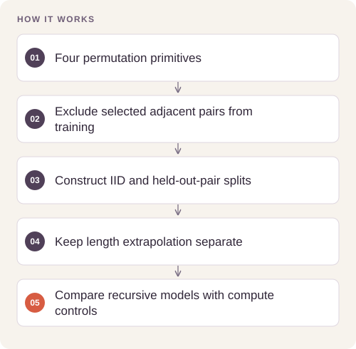

# Recursive Composition Benchmark

**Feras Elghandour**

Separate the effects of tree shape, shared composition, and staged training in a controlled compositional-learning task.

## Implementation

A finite-state synthetic benchmark with nine conditions, five seeds, explicit parameter/compute controls, finite-difference gradient checks, learned weights, and inspectable generalization splits.



## Try a small example

The example inspects the generated train and held-out-pair split boundaries. It does not train the nine model conditions or rerun the five-seed benchmark.

After the local setup below, run from the repository root:

```sh
python examples/quickstart.py
```

The [example source](examples/quickstart.py), [captured output](examples/expected-output.txt) and [execution record](examples/environment.json) keep this demonstration inspectable. Floating-point values may vary with library versions.

Observed output from this run:

```text
{'train_3': [38, 3], 'ood_3': [16, 3], 'long_8': [512, 8], 'train_has_forbidden': False, 'ood_has_forbidden': True}
{'target_first_train': [[2, 1, 3, 0]]}
```

## Evidence and results

The saved five-seed study reports **4.4%** held-out-pair accuracy for balanced staged composition versus **42.1%** for left staged composition; a known-algebra baseline reaches **100%**. Fresh audit passes regenerate all five datasets and exactly reproduce three representative seed-0 runs, including weights, training histories, and metrics.

## Run locally

Python 3.11 or later; use an isolated environment.

```sh
python -m pip install -r requirements.txt
python experiment.py --verify
python audit.py
```

For a new full experiment: `python experiment.py --out reproduced_results`, then `python summarize.py --results reproduced_results`. A shorter engineering run can use `--seeds 0 --methods seed_balanced --steps 60 --out smoke`. Steps must be divisible by six. [Protocol](PROTOCOL.md) and [report](REPORT.md) explain the controls.

## Scope and limitations

The experiment rejects the balanced-growth hypothesis in this implementation. The algebraic baseline has an information advantage. Results concern the defined four-state task and do not establish general reasoning or training-efficiency claims.

[Validation record](VALIDATION.md) · [Inputs and applicable notices](DATA.md)
